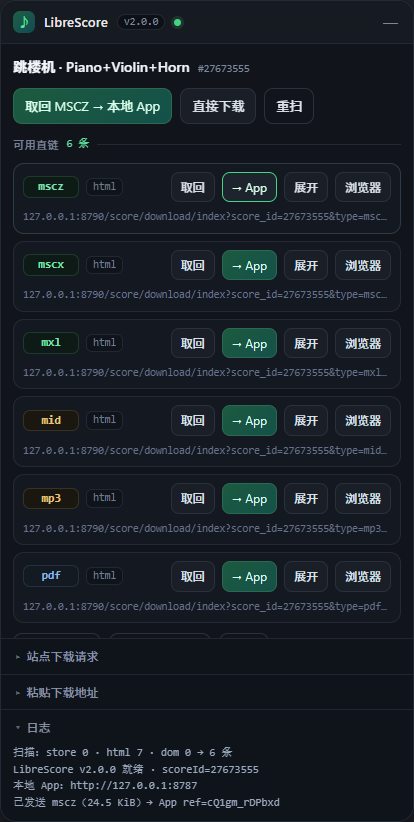

# musescore-fetcher

> MuseScore 全格式取回：**mscz / mscx / mxl / musicxml / mid / mp3 / pdf**，
> 需要时再在本地把 mscz 转成 **12 种格式**（含 flac / ogg / wav / png / svg / 分谱）。



---

## 灵感与归属

这个项目**受 [LibreScore/dl-librescore](https://github.com/LibreScore/dl-librescore) 启发**：

- 公共接口 `/api/jmuse` 的调用方式（`type=img|mp3|midi` + `md5(id+type+index+salt)` 取前 4 位做 `Authorization`）、
  以及"从站点构建包里抓 salt"的思路，来自该仓库的开源实现（MIT）。
- 本地转换（mscz → pdf/midi/audio/图片）用的是同一个引擎生态：[webmscore](https://github.com/LibreScore/webmscore)（libmscore 的 WebAssembly 构建）与
  `@librescore/fonts` / `@librescore/sf3`。

但它不是那个项目的分支或复刻，目标也不同：

| | dl-librescore（上游） | 本项目 |
|---|---|---|
| MP3 / MIDI / PDF | ✅（`jmuse` + 逐页拼 PDF） | ✅（同样的通路，另外支持直取） |
| **MSCZ / MSCX / MXL / MusicXML** | ❌（上游明确"URL 输入不可下载"） | ✅ 读页面自带 `type_download_list` |
| 抓站点自己的下载请求 | ❌ | ✅（挂页面真实 window 的 `fetch/xhr/a.click/open`） |
| 粘贴签名 URL 取回 | ❌ | ✅ |
| 12 种格式转换（含分谱/音频） | ✅ CLI 本地文件 | ✅ 本地服务 + 网页 |
| 形态 | 油猴脚本 + CLI | 油猴脚本 + 本地服务 + 网页 |

上游做得很扎实（它的 i18n、CLI、PDF 拼装都比本项目完善），本项目只是补上"原生工程文件"这一段，
并把界面重做成可诊断的形态。

---

## 两条腿

### 1. 油猴脚本（取文件）

`userscript/librescore-all.user.js` —— 单文件，装进 Tampermonkey / Violentmonkey。

- 读页面 SSR 里的 `type_download_list`（mscz/mxl/mid/mp3/pdf 的签名直链）
- 捕获站点点 Download 时自己发出的请求（`window.open` / `<a download>` / `fetch` / `XHR`）
- `jmuse` 兜底（只产 img/mp3/midi）
- 取不回时的三级降级：`页面 fetch → GM_xmlhttpRequest → 同 h 换格式 → 交给浏览器下载`
- 面板：格式徽标 + 来源 + **完整 URL（点击复制）** + 取回/→App/展开/浏览器；可拖动、可折叠、记住位置

### 2. 本地服务（转格式，可选）

```bash
npm install
npm start        # → http://127.0.0.1:8787
```

- 12 种格式：`pdf mscz mscx mxl musicxml mid mp3 flac ogg wav png(zip) svg`，支持分谱
- 搜索 / 元数据走官方移动端 API（不经过 Cloudflare）
- 「自动导入」监听下载文件夹（`WATCH_DIR`，默认 `~/Downloads`），浏览器下完的文件自动入队
- 浏览器引擎：直接驱动本机 Chrome/Edge 过 Cloudflare 取源文件

---

## 快速开始

```bash
git clone <this repo>
cd musescore-fetcher
npm install
npm start
# 浏览器打开 http://127.0.0.1:8787 ，同时把下面的脚本加进 Tampermonkey
# http://127.0.0.1:8787/librescore-all.user.js
```

只想要油猴脚本、不要本地服务？直接把 `userscript/librescore-all.user.js` 加进管理器即可，
「取回 / 直接下载」仍然可用，只是「→ App」和格式转换需要本地服务在线（面板右上角圆点显示状态）。

---

## 数据是怎么来的

```
页面 DOM
 ├─ type_download_list  →  mscz / mscx / mxl / musicxml / mid / mp3 / pdf 的签名 URL（同一个 h 通吃）
 └─ 站点自己的下载动作   →  window.open / <a download> / fetch / XHR（钩子捕获）
jmuse 接口（公开）        →  img / mp3 / midi（从不给 mscz）
CDN（无 CF）              →  第 1 页渲染图（预览用）
```

`h` 是服务端签发的，客户端算不出来；是否真给文件由站点的权限字段决定
（`is_free` / `hasAccess` / `is_download_limited` / `paywall`），本项目只做读取，不绕过。

---

## 已验证 / 已知限制

**跑通过**

- 12 种格式转换（真实 `.mscz` 133 KiB → 12 个文件，5.6 MB ZIP）
- 油猴：解析 `type_download_list` → 取回 24.5 KiB mscz → 送本地服务 → 转 5 种格式
- 油猴：页面无列表时 jmuse 兜底；`window.open` 式下载能被捕获；粘贴带 `__cf_chl_tk` 的 URL 可取回
- 本地服务：jmuse 契约 mock（含错误 salt 反例）、浏览器引擎 mock（跟随 302）、下载夹自动导入（会校验文件头）
- 官方移动端 API：`/common/hello`、`/score/search` 实测 200

**限制（不是实现问题）**

- `jmuse` 永远不给 mscz —— 它是播放器接口
- 桌面端 `api.musescore.com/v2/score/file` 需要服务端签发的 `key`；移动端 `urls.mscze` 被 Play Integrity 锁死 → 第三方客户端无解
- 站点按账号拦（402/403 JSON）时，任何客户端都拿不到；作者关闭下载同理
- 开发机出口是数据中心 IP，Cloudflare 直接 403，因此 `type_download_list` 的真实抓取只能在你自己的浏览器里发生

---

## 目录

```
musescore-fetcher/
├─ userscript/librescore-all.user.js   # 油猴脚本（单文件，v2.0.0）
├─ server/                             # 本地服务
│  ├─ index.mjs                        # HTTP 路由 / 作业库 / 自动导入
│  ├─ convert.mjs                      # webmscore：12 种格式
│  ├─ browser-engine.mjs               # 驱动本机浏览器取源文件
│  ├─ fetcher.mjs                      # curl_cffi（浏览器 TLS 指纹）+ fetch 兜底
│  ├─ watcher.mjs                      # 下载文件夹监听（校验文件头）
│  └─ sources/{jmuse,mobile-api,cdn,official}.mjs
├─ web/                                # 本地网页 UI
├─ tools/{verify,probe}.mjs            # 能力矩阵自检 / 通道探测
├─ test/                               # mock 契约 + e2e + 样例
└─ docs/{DESIGN.md,panel.png}
```

---

## 免责

仅供个人学习与备份自己可访问的乐谱。请遵守 MuseScore 的服务条款与作者授权；
本项目不包含任何绕过付费/权限的逻辑，站点不给的文件它同样拿不到。

## License

MIT。上游 [dl-librescore](https://github.com/LibreScore/dl-librescore) 与本项目同为 MIT；
`webmscore` 为 GPL，按需通过 npm 依赖引入，未修改分发。
